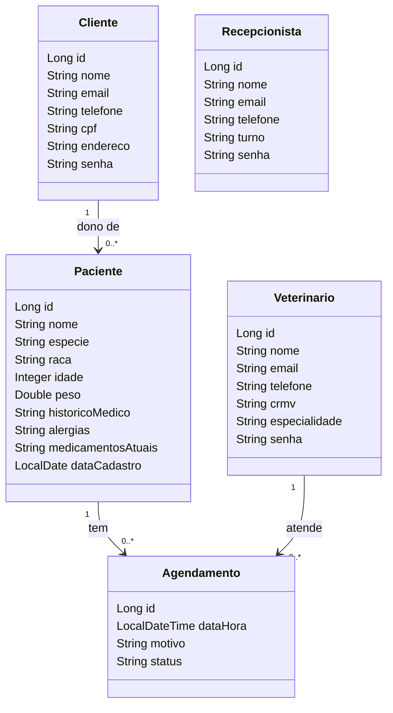

# Sistema Veterinário

- `vet-backend/` — API em Spring Boot (login com JWT, CRUD de clientes, pacientes, veterinários, recepcionistas e agendamentos, dashboard e chat com IA via Gemini)
- `vet-frontend/` — Angular 22 com NgModules (`standalone: false`), roteamento, SSR desligado e Angular Material
- `vet-backend/postman/` — coleção Postman (o login guarda o token sozinho)

## Rodar localmente

**Backend** (JDK 21 ou superior):

```bash
cd vet-backend
export GEMINI_API_KEY=sua-chave
export GEMINI_MODEL=nome-do-modelo
export JWT_SECRET=um-texto-aleatorio-com-mais-de-32-caracteres
export ADMIN_EMAIL=voce@email.com        # só no primeiro start, com o banco vazio
export ADMIN_SENHA=uma-senha-forte       # mínimo 8 caracteres
./mvnw spring-boot:run
```

No Windows (PowerShell) use `$env:GEMINI_API_KEY="..."` no lugar de `export`.
Para ver o sistema com dados de exemplo: `SEED_DEMO=true` e `SEED_SENHA=outra-senha` (cria Dr. Carlos,
Maria e João com 3 pets). Use só para demonstração.

**Frontend:**

```bash
cd vet-frontend
npm install
npm start          # http://localhost:4200 — o proxy.conf.json encaminha /api para localhost:8080
```

## Variáveis de ambiente do backend

| Variável | Obrigatória | Para quê |
|---|---|---|
| `GEMINI_API_KEY` | sim | chave do Gemini (nunca vai para o Git nem para o frontend) |
| `GEMINI_MODEL` | sim | modelo do Gemini; `GEMINI_MODEL_RESERVA` é opcional |
| `JWT_SECRET` | sim | assina os tokens de login; mínimo 32 caracteres aleatórios |
| `CORS_ORIGINS` | em produção | URL(s) do frontend, separadas por vírgula (ex.: `https://meu-vet.netlify.app`) |
| `JDBC_DATABASE_URL`, `DB_USER`, `DB_PASSWORD` | em produção | PostgreSQL. Sem isso usa H2 em arquivo (`data/vetdb`), que **some** em hospedagem sem disco persistente |
| `ADMIN_EMAIL`, `ADMIN_SENHA`, `ADMIN_NOME`, `ADMIN_CRMV` | no 1º acesso | cria o primeiro veterinário quando o banco está vazio |
| `PORT` | automática | a hospedagem define; o padrão é 8080 |
| `LIMITE_LOGIN`, `LIMITE_IA` | não | requisições por minuto por IP (padrão 10 e 20) |

## Publicar

1. **Banco:** crie um PostgreSQL na hospedagem e copie a URL no formato JDBC (`jdbc:postgresql://host:5432/banco`).
2. **Backend:** crie um serviço Docker apontando para a pasta `vet-backend` (há um `Dockerfile`). Cadastre as variáveis acima.
   Teste em `https://SEU-BACKEND/api/health` (deve responder `{"status":"ok"}`).
3. **Frontend:** edite `vet-frontend/src/environments/environment.ts` com a URL do backend e publique:
   - build: `npm ci && npm run build`
   - pasta publicada: `dist/vet-frontend/browser`
   - o arquivo `public/_redirects` (Netlify/Cloudflare Pages) e o `vercel.json` já enviam todas as rotas para o `index.html`.
4. Volte ao backend e coloque a URL do frontend em `CORS_ORIGINS`.
5. Entre com o `ADMIN_EMAIL`/`ADMIN_SENHA`, cadastre clientes e pacientes. Depois pode apagar `ADMIN_SENHA` das variáveis.

## Como o acesso funciona

- Login em `POST /api/auth/login` devolve um token (12 h). O frontend envia `Authorization: Bearer ...`.
- **Veterinário:** tudo, inclusive excluir registros, cadastrar veterinários/recepcionistas e usar o chat de IA.
- **Recepcionista:** cadastra e edita clientes, pacientes e agendamentos; consulta veterinários e recepcionistas. Não exclui nem usa a IA.
- **Cliente:** vê somente os próprios pets. O servidor decide pelo token, não por um id enviado.
- Login e IA têm limite de requisições por IP.

## Telas (frontend)

Após o login, veterinário e recepcionista entram em `/app`: **Dashboard** (4 indicadores, pacientes por espécie e próximos agendamentos),
**Agendamentos**, **Pacientes**, **Clientes**, **Veterinários**, **Recepcionistas** (cada um com cadastro, edição e exclusão)
e **Assistente IA** (só veterinário). Cliente entra em `/cliente`.

Fluxo principal para testar: cadastrar cliente → cadastrar paciente (escolhendo o dono) → criar agendamento (paciente + veterinário + data/hora)
→ ver o resultado em Agendamentos e no Dashboard. Dois agendamentos no mesmo horário para o mesmo veterinário são recusados.

## Instruções de acesso para teste (professor)

Informe aqui, na entrega, o endereço publicado e um usuário de teste:

- Endereço: `https://SEU-SITE.netlify.app`
- E-mail: `________` Senha: `________` (veterinário)

A primeira abertura pode levar cerca de 1 minuto se a hospedagem gratuita estiver "dormindo".

## Diagrama de classes



A senha é sempre guardada como hash BCrypt. Recepcionista não se relaciona com as outras entidades: ela opera o sistema (cadastros e agendamentos).
